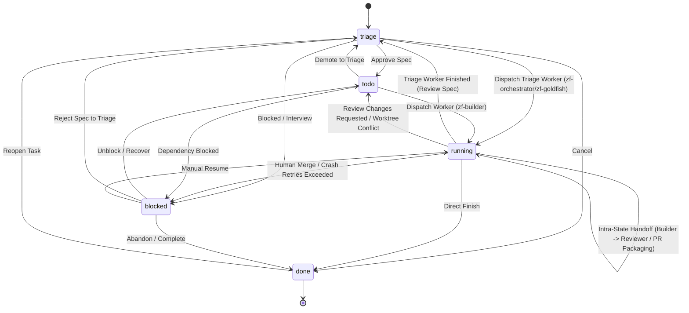

# Zero Factory Codebase Consolidation & Process Tracking Simplification

*   **Author:** ntsd
*   **Status:** In Review
*   **Date:** 2026-11-10

---

## Overview

Zero Factory is a multi-agent orchestration plugin for Hermes that coordinates autonomous software engineering workflows across builder, reviewer, and orchestrator agents. Currently, worker process tracking is split between SQLite database rows and ephemeral Python in-memory dictionaries (`_active_workers`, `_active_scanners`). Because the Dashboard server, periodic watchdog routines, and CLI commands (`hermes zerofactory ...`) execute in independent OS processes, in-memory process handles are not shared across process boundaries. Subprocesses completing normally or exiting between polling intervals are frequently misdiagnosed as lost or crashed workers by sibling processes, triggering false retries and unwanted task blocks.

Additionally, task lifecycle state transitions and metadata cleanups are scattered across more than 20 raw SQL statements in CLI handlers, FastAPI routes, and dispatcher routines. This fragmentation causes inconsistent state persistence where ephemeral flags (such as interview blocks or stale worker PIDs) leak across status transitions.

This design consolidates Zero Factory around:
1. Durable OS PID and atomic `.exit` file process tracking backed by first-class SQLite columns on `tasks`.
2. A single transactional state machine module governing all task state transitions and ephemeral resource teardowns.
3. Complete elimination of custom cron scheduling abstractions, Jira integrations, and runtime monkeypatch facades in favor of direct dispatcher loops and a consolidated clean-install initial SQL migration (`migrations/0001_initial_schema.sql`).

---

## The Problem

1. **Split-Brain Worker Tracking Across OS Processes:** Zero Factory runs across multiple OS processes: the dashboard web server, background CLI runs (`hermes zerofactory dispatch`), watchdog scripts, and cron ticks. Spawning a worker records its `subprocess.Popen` handle only in the spawning process's memory. When another process executes a reaping cycle, it cannot access the child's `Popen` object. If the child process has exited (even with returncode 0), the checking process diagnoses it as a missing process, increments failure counts, and blocks the task.
2. **Zombie Process Timing Window:** When a child process terminates, it remains a zombie in the OS process table until reaped by its parent process. When sibling processes inspect `/proc/<pid>/status`, they observe state `Z` (Zombie) and deem the process dead with no access to its final exit code.
3. **Distributed and Unsynchronized State Transitions:** Task status changes, metadata cleanups, and activity logging are implemented ad-hoc across 20+ SQL `UPDATE tasks SET ...` calls in `dashboard/routes/tasks.py`, `dispatcher/scheduler.py`, `dispatcher/reaper.py`, and `dispatcher/worktree.py`. Transient metadata (such as interview requests, worker PIDs, or block flags) is frequently left uncleared when tasks transition across states.
4. **Redundant Subsystems and Private API Coupling:** Over 3,500 lines of custom cron coordination code (`cron/`, `builtin_cron.py`, `scripts/zf_scanner_gate.py`) mirror job definitions into Hermes configuration files and invoke private Hermes scheduler internals (`cron.scheduler.tick`), triggering catalog validation errors and maintenance churn. Auxiliary integrations like Jira increase unused code surface.

---

## Goals

*   Establish durable OS process tracking using explicit SQLite columns (`worker_pid`, `started_at`, `blocked_reason`) and atomic `.exit` status files written upon worker termination.
*   Centralize all task status, assignee, and metadata mutations into a single transactional state machine (`dispatcher/state_machine.py`) shared by the CLI, Dashboard HTTP routes, and Dispatcher.
*   Eliminate the custom `cron/` package and all private Hermes imports (`cron.scheduler.*`), allowing native dispatcher cycles to directly govern queue audits and idle board scans.
*   Consolidate SQLite schema definitions into a single clean-install initial schema (`migrations/0001_initial_schema.sql`), remove intermediate migration files (`migrations/0002_add_automerge.sql`) and dynamic `PRAGMA table_info` introspection queries in `dispatcher/scheduler.py`.
*   Remove Jira integrations, dynamic monkeypatch facades (`_d()`), and legacy `ImportError` guards.
*   Achieve clean catalog compliance with zero warnings on `hermes plugins validate`.

---

## Non-Goals

*   Modifying core Zero Factory agent workflows: multi-repo Git worktrees, sequential EGM triage with `zf-goldfish`, 2-round thematic PR reviews, OpenWiki generation, or Mem0 vector memory.
*   Supporting backward-compatible schema migration of existing user `kanban.db` databases (clean-install schema only).
*   Adding external process managers or supervising daemons (e.g. systemd, supervisord); tracking must remain self-contained using OS primitives.

---

## Open Questions

*   None currently identified.

---

## Critical User Journeys (CUJs)

### CUJ 1: Autonomous Worker Execution Across Independent Processes

*   **Given**: A task is in `todo` status assigned to `zf-builder`. The dashboard server is idling, and the user triggers a dispatch cycle via CLI (`hermes zerofactory dispatch`).
*   **When**: The dispatcher CLI process atomically claims the task in SQLite (`UPDATE tasks SET status = 'running' WHERE id = ? AND status = 'todo'`), provisions the Git worktree, unlinks any stale `.exit` files, and launches the agent subprocess with the atomic shell `.exit` wrapper, recording `worker_pid` and `started_at` in SQLite.
*   **Then**: When the worker completes before the next dashboard polling tick, the wrapper atomically writes exit code `0` to `~/.hermes/logs/worker_{task_id}.exit`. When the dashboard process subsequently runs `run_dispatch_cycle()`, it reads the exit file, determines that the worker succeeded cleanly with code `0`, advances the task to precommit verification and PR creation, and unlinks the `.exit` file.

### CUJ 2: Worker Crash / Failure Escalation

*   **Given**: An agent worker running a triage or builder task encounters an unhandled exception or terminates with an exit code greater than 0.
*   **When**: The wrapper script writes the non-zero integer exit code to the `.exit` file, or the process terminates abruptly without an exit file (e.g. SIGKILL).
*   **Then**: The next dispatch cycle detects the non-zero exit code (or dead PID without exit file), records the failure in task metadata retries, and if retries exceed the retry budget (3), executes a transition to `blocked` status via the state machine with `blocked_reason` explaining the worker exit code.

### CUJ 3: Interactive Task State Mutation via CLI or Web Dashboard

*   **Given**: A task is in `running` status with an active agent worker subprocess.
*   **When**: A user clicks "Block" or "Move to Todo" in the dashboard, or runs `hermes zerofactory move <task_id> todo`.
*   **Then**: The API route invokes `state_machine.transition_task(...)`. The state machine terminates the active process group via `worker_pid`, unlinks any pending `.exit` file, clears `worker_pid`, `started_at`, and transient metadata, updates the task row, and inserts an audit record in `task_activity` within a single SQLite transaction.

### CUJ 4: Periodic Queue Watchdog and Idle Board Scanning

*   **Given**: Zero Factory is installed with active boards and no external cron daemon.
*   **When**: The native dispatcher background loop executes its periodic tick (`run_dispatch_cycle()`).
*   **Then**: The dispatcher runs queue watchdog assertions in-process, checks per-board active worker limits against LLM worker capacity, and if a board is eligible, directly spawns `zf-orchestrator` improvement scans via the standardized `.exit` wrapper without referencing `cron.scheduler` or reading `jobs.json`.

---

## Technical Plan (Architecture)

### 1. Durable Subprocess Tracking & Atomic Exit Files

Replace in-memory process tracking with a persistent OS-level mechanism:

```mermaid
sequenceDiagram
    autonumber
    participant Spawner as Spawning Process (CLI / Web)
    participant Shell as Subprocess Shell Wrapper
    participant Agent as Hermes Agent Worker
    participant Disk as Log & Exit Files
    participant DB as SQLite kanban.db
    participant Reaper as Reaping Process (Any OS Process)

    Spawner->>DB: Atomic Claim: UPDATE tasks SET status='running' WHERE id=? AND status='todo'
    Spawner->>Disk: Unlink any existing .exit/.tmp files
    Spawner->>Shell: Spawn with sh -c wrapper in new process group
    Spawner->>DB: UPDATE tasks SET worker_pid=PID, started_at=NOW
    Shell->>Agent: Run command ("$@")
    Agent-->>Shell: Exits with return code RC
    Shell->>Disk: Trap captures RC; printf "%d\n" $rc > .exit.tmp && mv .exit.tmp .exit
    Reaper->>DB: Query running tasks (worker_pid)
    Reaper->>Disk: Check if .exit file exists
    alt Exit file exists
        Disk-->>Reaper: Read RC (e.g. 0 or 1)
        Reaper->>DB: Transition task (advance on 0, retry/block on >0)
        Reaper->>Disk: Unlink .exit file
    else Exit file missing
        Reaper->>Reaper: Check /proc/PID status & verify process commandline
        alt PID alive and state != 'Z'
            Reaper->>Reaper: Still executing (no-op)
        else PID dead or 'Z'
            Reaper->>DB: Process died before trap; record crash
        end
    end
```

#### Shell Execution Wrapper Contract
Every agent worker and background scanner is launched via `subprocess.Popen` in a new process group (`start_new_session=True`). The wrapper traps normal exit as well as `SIGINT` and `SIGTERM`:

```bash
sh -c 'prefix="$1"; shift; trap "rc=\$?; printf \"%d\n\" \"\$rc\" > \"$prefix.exit.tmp\" && mv \"$prefix.exit.tmp\" \"$prefix.exit\"; exit \$rc" EXIT INT TERM; "$@"' dummy "$EXIT_FILE_PREFIX" [COMMAND ARGS...]
```

- `$EXIT_FILE_PREFIX.exit` is written to `~/.hermes/logs/worker_{task_id}.exit` (or `scanner_{board_slug}.exit`).
- Writing to a `.tmp` file followed by an atomic POSIX `rename` prevents readers from inspecting partially written exit code bytes.
- Python helper in `dispatcher/process_manager.py`:
  ```python
  def build_shell_wrapper(cmd: list[str], exit_prefix: Path | str) -> list[str]:
      script = (
          'prefix="$1"; shift; '
          'trap "rc=\\$?; printf \\"%d\\n\\" \\"\\$rc\\" > \\"${prefix}.exit.tmp\\" && '
          'mv \\"${prefix}.exit.tmp\\" \\"${prefix}.exit\\"; exit \\$rc" EXIT INT TERM; '
          '"$@"'
      )
      return ["sh", "-c", script, "zf-runner", str(exit_prefix)] + cmd
  ```

#### Process Health & Exit Detection
`dispatcher/process_manager.py` exposes:
```python
class ProcessState(str, enum.Enum):
    RUNNING = "RUNNING"
    COMPLETED = "COMPLETED"
    CRASHED = "CRASHED"


def get_process_exit_code(
    task_id: str, pid: Optional[int]
) -> Tuple[ProcessState, Optional[int]]: ...
def cleanup_process_artifacts(task_id: str) -> None: ...
def terminate_task_worker(task_id: str, pid: Optional[int]) -> None: ...
```
1. `get_process_exit_code`:
   - Checks `~/.hermes/logs/worker_{task_id}.exit`. If found, parses the integer exit code; returns `(COMPLETED, exit_code)`.
   - If exit file is missing:
     - If `pid` is provided, verifies process liveness via `/proc/{pid}/status` (checking state != `'Z'`).
     - Validates process identity by inspecting `/proc/{pid}/cmdline` for `"hermes"` or `task_id` before verifying running state.
     - If process exists and is not a zombie, returns `(RUNNING, None)`.
     - If process is missing or zombie, returns `(CRASHED, -1)`.
2. `terminate_task_worker`:
   - Pre-checks process identity in `/proc/{pid}/cmdline`.
   - Sends `SIGTERM` to the process group (`os.killpg(pid, signal.SIGTERM)`), waits up to 2 seconds, and escalates to `SIGKILL` if still alive.
   - Unlinks lingering `.exit` and `.tmp` files.

---

### 2. First-Class Task Columns on SQLite Schema

Promote high-frequency task attributes stored within JSON metadata strings into dedicated columns in `migrations/0001_initial_schema.sql`:

```sql
CREATE TABLE tasks (
    id TEXT PRIMARY KEY,
    board_slug TEXT NOT NULL,
    title TEXT NOT NULL,
    description TEXT NOT NULL DEFAULT '',
    status TEXT NOT NULL DEFAULT 'triage',
    assignee TEXT NOT NULL DEFAULT 'human',
    priority TEXT NOT NULL DEFAULT 'medium',
    worker_pid INTEGER DEFAULT NULL,
    started_at INTEGER DEFAULT NULL,
    blocked_reason TEXT DEFAULT NULL,
    metadata TEXT NOT NULL DEFAULT '{}',
    created_at INTEGER NOT NULL,
    updated_at INTEGER NOT NULL
);
```

- `worker_pid`: Holds the OS PID of the running worker wrapper. Set on worker launch, cleared on state transitions out of `running`.
- `started_at`: Integer Unix epoch seconds recording when the active worker was launched.
- `blocked_reason`: Structured explanation when a task is moved to `blocked` (e.g. `pr_changes_requested`, `worker_crash`, `merge_conflict`, `human_review`).
- Note: Ephemeral triage sub-phases remain in `metadata` (`metadata["triage_phase"]`) to avoid unnecessary column proliferation. `jira_url` is stripped from `boards`.

---

### 3. Unified Transactional Task State Machine (`dispatcher/state_machine.py`)

A single module governs all task lifecycle mutations across the CLI, Web API, and Dispatcher engine.



#### State Transition Contract
```python
VALID_TRANSITIONS: dict[str, set[str]] = {
    "triage": {"todo", "running", "blocked", "done"},
    "todo": {"running", "blocked", "triage"},
    "running": {"todo", "triage", "running", "blocked", "done"},
    "blocked": {"todo", "triage", "running", "done"},
    "done": {"triage"},
}


class InvalidStateTransitionError(ValueError):
    pass


def transition_task(
    conn: sqlite3.Connection,
    task_id: str,
    target_status: str,
    target_assignee: Optional[str] = None,
    blocked_reason: Optional[str] = None,
    metadata_patch: Optional[Dict[str, Any]] = None,
    worker_pid: Optional[int] = None,
    started_at: Optional[int] = None,
    actor: str = "system",
    comment: Optional[str] = None,
) -> dict[str, Any]: ...
```

#### Two-Phase Teardown & Transition Protocol
1. **Pre-Transition Validation**:
   - Verify `(current_status -> target_status)` against `VALID_TRANSITIONS`. Raise `InvalidStateTransitionError` if illegal.
2. **Phase 1: OS Resource Teardown (Outside Database Transaction)**:
   - When transitioning *out* of `running` (or reassigning to a new worker within `running`):
     - If `old_worker_pid` is present, invoke `terminate_task_worker(task_id, old_worker_pid)`.
     - Unlink `.exit` and `.tmp` files.
3. **Phase 2: Atomic SQLite Persistence (`BEGIN IMMEDIATE`)**:
   - Clean up transient metadata:
     - When exiting `blocked`: Clear `blocked_reason = NULL`, reset `worker_failure_retries` counter in metadata.
     - When entering `todo`: Clear ephemeral flags (`awaiting_interview`, `reply_interview`).
     - When exiting `running`: Reset `worker_pid = NULL`, `started_at = NULL` (unless updating new worker credentials).
   - Execute `UPDATE tasks SET status = ?, assignee = ?, blocked_reason = ?, worker_pid = ?, started_at = ?, metadata = ?, updated_at = ? WHERE id = ?`.
   - Insert activity log matching `task_activity` schema:
     ```python
     conn.execute(
         "INSERT INTO task_activity (task_id, actor, action, details, created_at) VALUES (?, ?, 'status_change', ?, ?)",
         (task_id, actor, f"{old_status} -> {target_status}", int(time.time())),
     )
     ```
   - Insert comment into `task_comments` if `comment` is supplied.
   - Commit transaction.

---

### 4. Dispatcher-Driven Periodic Tasks & Elimination of `cron/`

The custom `cron/` package (manager, definitions, store, executor) and `builtin_cron.py` duplicate scheduling logic already managed by Hermes and the dispatcher. Private Hermes internal imports (`cron.scheduler.tick` and `cron.scheduler.get_running_job_ids`) violate catalog validation rules.

Consolidate periodic tasks directly into `dispatcher/scheduler.py`:
1. **Periodic Dispatch Tick**: The native Hermes hook `on_kanban_dispatch_tick` and background polling threads call `run_dispatch_cycle()`.
2. **In-Process Watchdog**:
   - Checks running tasks for stuck processes or expired timeouts using `get_process_exit_code()`.
   - Reaps terminated processes based on `.exit` files.
3. **Integrated Board Improvement Scans**:
   - `dispatcher/scanner.py` inspects active boards under the cross-process dispatch file lock.
   - Checks if active workers across the board are below concurrency limits and if the board scan cooldown period (e.g. 2 hours) has elapsed.
   - Spawns `zf-orchestrator` improvement scans directly:
     ```python
     cmd = [
         hermes_bin,
         "-p",
         "zf-orchestrator",
         "--yolo",
         "--cli",
         "--accept-hooks",
         "chat",
         "-q",
         prompt,
     ]
     ```
     tracked via the shell wrapper and `.exit` file standard (`~/.hermes/logs/scanner_{board_slug}.exit`).
   - Removes all calls to `cron.scheduler.*` and deletes `cron/` and `builtin_cron.py`.

---

### 5. Removal of Jira, Initial Schema Consolidation & Facade Elimination

1. **Remove Jira Support**:
   - Delete `issues/jira.py`.
   - Remove Jira imports and endpoints from `dashboard/routes/boards.py`, `dashboard/models.py`, `issues/__init__.py`, and `__init__.py`.
   - Issue import standardizes strictly on GitHub issues (`issues/importer.py` / `issues/github.py`).
2. **Consolidate Initial Schema in `migrations/`**:
   - Consolidate initial tables, automerge columns, and new task columns (`worker_pid`, `started_at`, `blocked_reason`) into `migrations/0001_initial_schema.sql`.
   - Delete `migrations/0002_add_automerge.sql`.
   - Retain `migrations/runner.py` for standard migration execution during `dashboard/db.py` initialization (`init_db()`).
   - Remove dynamic `PRAGMA table_info` introspection queries in `dispatcher/scheduler.py` (lines 98–106) and clean up `_load_scanner_gate_module()` in `dashboard/db.py`.
3. **Eliminate Dynamic Monkeypatches & Facades**:
   - Remove `_d()` dynamic indirection wrappers in `dispatcher/config.py` and `dispatcher/scheduler.py`.
   - Standardize direct Python imports across all internal modules.
   - Flatten nested `try/except ImportError` blocks.
4. **Canonical Agent Role Configuration**:
   - Re-use existing `paths.PROFILE_MAP` and define `AGENT_ROLES = tuple(PROFILE_MAP)` in `paths.py`.
   - Update `dashboard/routes/agents.py` and `dashboard/session_service.py` to import `AGENT_ROLES` so that `zf-goldfish` is fully recognized alongside orchestrator, builder, and reviewer.

---

## Alternatives Considered

### Alternative A: Restrict Worker Dispatching Exclusively to the Dashboard Web Server Process

*   **Pros**: Allows keeping in-memory `_active_workers` dictionaries with live `subprocess.Popen` objects inside the web server process.
*   **Cons**: Breaks one-shot CLI commands (`hermes zerofactory dispatch`, `hermes zerofactory check-stuck`, `hermes zerofactory move`) and native scheduler hooks executed outside the web server. CLI-driven invocations would still suffer from split-brain process detection and false crash diagnoses.
*   **Reason for Rejection**: Zero Factory must support multi-process environments, CLI operations, and autonomous cron hooks without process handle loss.

### Alternative B: Retain Custom `cron/` Package and Mock Private Hermes Internal APIs

*   **Pros**: Preserves existing file layouts in `cron/` and requires fewer line deletions.
*   **Cons**: Retains 3,500+ lines of redundant coordination code (`cron/manager.py`, `cron/definitions.py`, `cron/executor.py`, `cron/store.py`, `builtin_cron.py`, `scripts/zf_scanner_gate.py`). Private core imports (`cron.scheduler.tick` and `cron.scheduler.get_running_job_ids`) violate Hermes plugin catalog rules (`hermes plugins validate` Catalog Rule 9).
*   **Reason for Rejection**: The dispatcher loop and `on_kanban_dispatch_tick` hook already drive periodic queue checks and idle board scans directly. The entire custom cron synchronization layer is unnecessary maintenance overhead.

### Alternative C: Maintain Multiple Incremental Migration Scripts

*   **Pros**: Preserves historical step-by-step upgrade files (`0001_initial_schema.sql`, `0002_add_automerge.sql`).
*   **Cons**: Increases initialization complexity and creates churn from running sequential migrations across beta iterations.
*   **Reason for Rejection**: Consolidating the full schema into `migrations/0001_initial_schema.sql` preserves the migration runner and clean initial SQL without incremental file proliferation.

### Alternative D: Retain Jira Issue Importer as an Optional Subsystem

*   **Pros**: Keeps theoretical Jira issue import capability.
*   **Cons**: Adds 311 lines of unmaintained integration code in `issues/jira.py`, routes in `dashboard/routes/boards.py`, and data models in `dashboard/models.py`.
*   **Reason for Rejection**: GitHub issue integration is the primary workflow for Zero Factory. Maintaining a second issue tracker abstraction increases unused code surface.

---

## Risks & Limits

| Risk / Failure Mode | Severity | Impact | Mitigation Strategy |
|---|---|---|---|
| **Multi-Process SQLite Lock Contention** | High | `OperationalError: database is locked` on concurrent writes across CLI, Web, and Watchdog. | Configure mandatory `busy_timeout = 15000` (15s) on all connections; prohibit filesystem and worktree operations inside transactions; wrap transitions in retry backoff. |
| **OS PID Recycling / Collision** | Medium | A dead worker's recycled PID could match an active unrelated process, causing ghost workers or killing unrelated processes. | Inspect `/proc/{pid}/cmdline` for `"hermes"` or `task_id` before verifying liveness or sending signals via `terminate_task_worker()`. |
| **Non-Linux Platform Limitations** | Medium | `/proc` is unavailable on macOS/BSD; `os.kill(pid, 0)` succeeds for unreaped zombie processes. | Standard worker exit detection relies primarily on atomic `.exit` files written by the shell wrapper. On non-Linux systems, fall back to `os.kill(pid, 0)` with documented limitation. |
| **Unhandled SIGKILL / Kernel OOM** | Medium | Process killed before shell trap runs, leaving no `.exit` file. | The reaper detects a dead PID with no `.exit` file after timeout and treats it as `ProcessState.CRASHED`, incrementing failure retries and escalating to `blocked` if budget is exceeded. |
| **Double-Dispatch Race Condition** | High | Sibling processes launch duplicate workers for the same task. | Enforce atomic task claiming in SQLite within `BEGIN IMMEDIATE` (`UPDATE tasks SET status='running' WHERE id=? AND status='todo'`) *prior* to provisioning worktrees or spawning subprocesses. |

---

## Non-Functional Requirements

### Performance & Overhead
*   **Filesystem-Based State Tracking**: Process state detection uses standard filesystem primitives (`.exit` file check, `/proc/<pid>/status` read on Linux) requiring zero background daemons or socket servers.
*   **Low Lock Contention**: All state machine mutations execute in atomic SQLite transactions (`BEGIN IMMEDIATE`) with Write-Ahead Logging (`WAL` mode), targeting database lock durations under 5ms per single-row transition.

### Reliability & Fault Tolerance
*   **Atomic State Visibility**: Atomic rename (`mv .exit.tmp .exit`) prevents concurrent processes from reading incomplete exit codes.
*   **Process Group Termination**: Transitions away from `running` terminate the full process group (`os.killpg`) to eliminate orphan agent processes.

### Plugin Catalog Compliance
*   **Zero Validation Warnings**: Elimination of private core imports (`cron.scheduler.*`) ensures compliance with `hermes plugins validate` constraints.

---

## Detailed Implementation Plan

### Implementation Checklist (Phasing & Checkpoints)

1. **Phase 1: Database Schema Consolidation in Initial Migration**
   - Consolidate initial tables, automerge columns, and first-class task tracking columns (`worker_pid`, `started_at`, `blocked_reason`) into `migrations/0001_initial_schema.sql`.
   - Strip `jira_url` from `boards` table in `migrations/0001_initial_schema.sql`.
   - Delete `migrations/0002_add_automerge.sql`.
   - Clean up `_load_scanner_gate_module()` in `dashboard/db.py`.
   - Update `tests/unit/test_migrations.py` to assert against clean initial schema.
   - **Checkpoint**: Run `pytest tests/unit/test_migrations.py`. All tests pass.

2. **Phase 2: Durable Process Tracking & Shell Exit Wrapper**
   - Implement `build_shell_wrapper()`, `ProcessState` enum, `get_process_exit_code()`, and `terminate_task_worker()` in `dispatcher/process_manager.py`.
   - Update `dispatcher/worker_spawner.py` to unlink existing `.exit` files prior to launch, invoke workers via `build_shell_wrapper()`, and record `worker_pid` and `started_at` in SQLite.
   - Remove `_active_workers` and `_active_scanners` dictionaries from `dispatcher/config.py`.
   - Update `tests/unit/dispatcher/test_process_manager.py` and `tests/unit/dispatcher/test_worker_spawner.py`.
   - **Checkpoint**: Run `pytest tests/unit/dispatcher/test_process_manager.py tests/unit/dispatcher/test_worker_spawner.py`. All tests pass.

3. **Phase 3: Unified Transactional Task State Machine**
   - Create `dispatcher/state_machine.py` implementing `VALID_TRANSITIONS`, `InvalidStateTransitionError`, and `transition_task()`.
   - Implement the two-phase teardown protocol: OS process termination first, then atomic SQLite update with `task_activity` logging and transient flag cleanups.
   - Refactor `dispatcher/reaper.py` to read `.exit` files and route transitions through `state_machine.transition_task()`. Fix `UnboundLocalError` on `curr_asgn`.
   - Refactor `dispatcher/worktree.py` to route precommit retry failures and merge conflicts through `state_machine.transition_task()`.
   - Refactor `dashboard/routes/tasks.py` and `dispatcher/scheduler.py` to replace all raw SQL mutations with `state_machine.transition_task()`. Remove dynamic `PRAGMA table_info` introspection in `scheduler.py`.
   - Create `tests/unit/dispatcher/test_state_machine.py` and update `tests/unit/dispatcher/test_reaper.py`, `tests/unit/dispatcher/test_worktree.py`, and `tests/unit/dispatcher/test_scheduler.py`.
   - **Checkpoint**: Run `pytest tests/unit/dispatcher`. All tests pass.

4. **Phase 4: Subsystem Pruning (Jira & Dynamic Facades)**
   - Delete `issues/jira.py`. Remove Jira endpoints from `dashboard/routes/boards.py`, remove Jira references from `issues/__init__.py`, `issues/importer.py`, and remove `JiraSetupRequest` from `dashboard/models.py`.
   - Delete `tests/unit/dashboard/test_jira_routes.py`.
   - Remove `_d()` dynamic indirection functions from `dispatcher/config.py` and `dispatcher/scheduler.py`.
   - Re-use `paths.PROFILE_MAP` and define `AGENT_ROLES = tuple(PROFILE_MAP)` in `paths.py`. Update `dashboard/routes/agents.py` and `dashboard/session_service.py` to import `AGENT_ROLES`.
   - Remove Jira CLI arguments from `__init__.py`.
   - **Checkpoint**: Run `pytest tests/unit/dashboard tests/unit/issues`. All tests pass.

5. **Phase 5: Dispatcher-Driven Periodic Automation & Catalog Compliance**
   - Delete custom `cron/` package (`manager.py`, `definitions.py`, `executor.py`, `store.py`, `scheduler_check.py`, `__init__.py`) and `builtin_cron.py`.
   - Delete `dashboard/routes/cron.py`, `scripts/zf_scanner_gate.py`, and `scripts/zf_queue_watchdog.py`.
   - Remove `cron_router` from `dashboard/routes/__init__.py` and `dashboard/plugin_api.py`.
   - Remove cron settings endpoints and `set_cron_scheduler_enabled` from `dashboard/routes/settings.py`.
   - Remove `CronJobUpdate`, `CronToggleRequest`, and `enable_cron_scheduler` from `dashboard/models.py`.
   - Remove cron CLI commands (`cron list`, `cron sync`, `cron run`) from `__init__.py`.
   - Update `dispatcher/scanner.py` to spawn `zf-orchestrator` directly via `build_shell_wrapper()`, removing private `cron.scheduler.*` imports.
   - Delete `tests/unit/cron/` and update `tests/e2e/test_cli_lifecycle.py` to remove obsolete cron CLI test cases.
   - **Checkpoint**: Run `pytest tests/unit tests/integration tests/e2e`. All tests pass.

6. **Phase 6: Full Verification Suite & Catalog Validation**
   - Run `ruff check .` and `ruff format --check .`.
   - Run complete unit and integration test suite: `pytest tests/`.
   - Run `hermes plugins validate .` to confirm zero Catalog Rule 9 warnings.

---

### Target Files to Create/Modify/Delete

#### Files to Create

1. **`dispatcher/state_machine.py`**
   *   **Type / Scope**: Python Core Dispatcher Module
   *   **Rationale**: Manages all task lifecycle transitions (`triage`, `todo`, `running`, `blocked`, `done`). Validates legal state transitions, executes OS process teardown prior to DB commits, clears transient metadata and failure counters, records audit logs in `task_activity`, and commits changes atomically in SQLite.
2. **`tests/unit/dispatcher/test_state_machine.py`**
   *   **Type / Scope**: Unit Test Suite
   *   **Rationale**: Validates legal transition rules, illegal transition exceptions, process group termination on exit from `running`, transient metadata cleanup, and database rollback integrity.

#### Files to Modify

3. **`migrations/0001_initial_schema.sql`**
   *   **Type / Scope**: Database Initial Migration Schema
   *   **Rationale**: Consolidate complete initial table schema, including `worker_pid INTEGER`, `started_at INTEGER`, `blocked_reason TEXT`, and automerge flags into the baseline migration script. Strip `jira_url` from `boards`.
4. **`migrations/runner.py`**
   *   **Type / Scope**: Database Migration Runner
   *   **Rationale**: Maintain migration execution on plugin startup while removing dynamic table column introspection.
5. **`dashboard/db.py`**
   *   **Type / Scope**: Database Initialization & Connection Layer
   *   **Rationale**: Configure connection `busy_timeout = 15000` (15s). Update `row_to_dict()` to include `worker_pid`, `started_at`, and `blocked_reason`. Remove `_load_scanner_gate_module()` and `_mark_scanner_task_created()`.
6. **`paths.py`**
   *   **Type / Scope**: Path & Constant Configuration
   *   **Rationale**: Define `AGENT_ROLES = tuple(PROFILE_MAP)` and define standard log directory path `WORKER_LOGS_DIR` (`~/.hermes/logs/`) for worker `.exit` files.
7. **`dashboard/models.py`**
   *   **Type / Scope**: Pydantic Data Models
   *   **Rationale**: Remove `JiraSetupRequest`, `CronJobUpdate`, `CronToggleRequest`, and remove `enable_cron_scheduler` from `SettingsUpdate`.
8. **`dispatcher/process_manager.py`**
   *   **Type / Scope**: Process Management Utilities
   *   **Rationale**: Implement `build_shell_wrapper()`, `ProcessState` enum, `get_process_exit_code()`, and `terminate_task_worker()` with `/proc/{pid}/cmdline` identity checks.
9. **`dispatcher/config.py`**
   *   **Type / Scope**: Dispatcher Configuration & Shared State
   *   **Rationale**: Remove global in-memory process tracking dictionaries (`_active_workers`, `_active_scanners`). Remove dynamic indirection wrappers (`_d()`).
10. **`dispatcher/worker_spawner.py`**
    *   **Type / Scope**: Worker Subprocess Launcher
    *   **Rationale**: Pre-clean existing `.exit` files for `task_id`, launch workers via `build_shell_wrapper()` in a new process group, and record `worker_pid` and `started_at` in the database.
11. **`dispatcher/reaper.py`**
    *   **Type / Scope**: Worker Health & Reaping Engine
    *   **Rationale**: Refactor `reap_active_workers()` to determine process termination using `dispatcher/process_manager.py` (.exit file detection and PID status). Fix `UnboundLocalError` on `curr_asgn`. Delegate all task status updates to `state_machine.transition_task()`.
12. **`dispatcher/scheduler.py`**
    *   **Type / Scope**: Dispatcher Main Loop & Worker Scheduling
    *   **Rationale**: Enforce atomic task claiming in SQLite prior to worker spawning. Replace raw SQL task updates with `state_machine.transition_task()`. Remove dynamic `PRAGMA table_info` queries (lines 98–106). Remove all private `cron.scheduler.*` references and Jira synchronization routines.
13. **`dispatcher/scanner.py`**
    *   **Type / Scope**: Improvement Scanner Subprocess Manager
    *   **Rationale**: Manage scanner subprocesses using `build_shell_wrapper()` instead of in-memory dictionaries. Remove private Hermes import `cron.scheduler.get_running_job_ids`.
14. **`dispatcher/worktree.py`**
    *   **Type / Scope**: Git Worktree Management
    *   **Rationale**: Route precommit retry failures and merge conflict escalations through `state_machine.transition_task()`.
15. **`dashboard/routes/tasks.py`**
    *   **Type / Scope**: FastAPI Task Endpoints
    *   **Rationale**: Replace raw SQL status update queries with `state_machine.transition_task()`. Ensure transient flags like `awaiting_interview` are consistently cleaned up.
16. **`dashboard/routes/boards.py`**
    *   **Type / Scope**: FastAPI Board Endpoints
    *   **Rationale**: Remove Jira configuration endpoints, validation handlers, and Jira board settings mutations.
17. **`dashboard/routes/agents.py`**
    *   **Type / Scope**: FastAPI Agent Information Endpoints
    *   **Rationale**: Import canonical agent role definitions (`AGENT_ROLES`) from `paths.py` to ensure `zf-goldfish` is recognized alongside builder, reviewer, and orchestrator.
18. **`dashboard/routes/settings.py`**
    *   **Type / Scope**: FastAPI Settings Endpoints
    *   **Rationale**: Remove `set_cron_scheduler_enabled` imports and cron settings toggle handlers.
19. **`dashboard/routes/__init__.py`**
    *   **Type / Scope**: FastAPI Route Aggregator
    *   **Rationale**: Remove `cron_router` import and mount.
20. **`dashboard/plugin_api.py`**
    *   **Type / Scope**: Plugin Public API Router
    *   **Rationale**: Remove `cron_router` mounting and re-exports of cron management helpers.
21. **`dashboard/session_service.py`**
    *   **Type / Scope**: Hermes Profile Session Service
    *   **Rationale**: Update session query logic to import `paths.AGENT_ROLES`.
22. **`issues/__init__.py`**
    *   **Type / Scope**: Issues Package Exports
    *   **Rationale**: Remove Jira importer exports.
23. **`issues/importer.py`**
    *   **Type / Scope**: Issue Ingestion Routing
    *   **Rationale**: Remove Jira import branches; standardize exclusively on GitHub issue ingestion.
24. **`__init__.py`**
    *   **Type / Scope**: Plugin Initialization & CLI Dispatcher
    *   **Rationale**: Remove `cron` and `jira` CLI subcommands and initializers. Wire CLI commands (`move`, `approve`, `reject`, `recover`) to `state_machine.transition_task()`.
25. **`tests/unit/dispatcher/test_process_manager.py`**
    *   **Type / Scope**: Unit Test Suite
    *   **Rationale**: Update test cases to verify `build_shell_wrapper()`, atomic exit code retrieval, zombie process status checks, and process group signal propagation.
26. **`tests/unit/dispatcher/test_reaper.py`**
    *   **Type / Scope**: Unit Test Suite
    *   **Rationale**: Update reaper test cases to mock filesystem `.exit` files and PID status rather than in-memory `Popen` handles. Validate correct retry escalation and transition to `blocked`.
27. **`tests/unit/dispatcher/test_worker_spawner.py`**
    *   **Type / Scope**: Unit Test Suite
    *   **Rationale**: Verify that worker spawning unlinks stale `.exit` files, builds the shell wrapper, assigns a process group, and records `worker_pid` and `started_at` in SQLite.
28. **`tests/unit/dispatcher/test_scheduler.py`**
    *   **Type / Scope**: Unit Test Suite
    *   **Rationale**: Update scheduling and dispatch cycle tests to assert interactions through the state machine and verify atomic task claims.
29. **`tests/unit/dispatcher/test_worktree.py`**
    *   **Type / Scope**: Unit Test Suite
    *   **Rationale**: Update worktree test cases to assert state machine transitions on precommit retries and merge conflicts.
30. **`tests/unit/dashboard/test_models.py`**
    *   **Type / Scope**: Unit Test Suite
    *   **Rationale**: Update model serialization assertions for removed Jira and cron models.
31. **`tests/unit/test_migrations.py`**
    *   **Type / Scope**: Unit Test Suite
    *   **Rationale**: Update migration unit tests to verify clean application of `0001_initial_schema.sql`.
32. **`tests/e2e/test_cli_lifecycle.py`**
    *   **Type / Scope**: End-to-End Test Suite
    *   **Rationale**: Remove obsolete cron CLI test cases (`test_05_cli_cron_and_dispatch`).

#### Files to Delete

33. **`migrations/0002_add_automerge.sql`**
    *   **Rationale**: Consolidated into `migrations/0001_initial_schema.sql`.
34. **`cron/`** (`manager.py`, `definitions.py`, `executor.py`, `store.py`, `scheduler_check.py`, `__init__.py`)
    *   **Rationale**: Custom cron subsystem superseded by native Hermes hooks and periodic dispatch loop; contains private core imports (`cron.scheduler.*`).
35. **`builtin_cron.py`**
    *   **Rationale**: Deprecated along with the `cron/` package.
36. **`dashboard/routes/cron.py`**
    *   **Rationale**: Endpoints no longer needed following removal of custom cron subsystem.
37. **`scripts/zf_scanner_gate.py`**
    *   **Rationale**: Scanner eligibility evaluation is directly driven by `dispatcher/scanner.py` during dispatch ticks.
38. **`scripts/zf_queue_watchdog.py`**
    *   **Rationale**: Queue watchdog checks are directly executed within `run_dispatch_cycle()`.
39. **`issues/jira.py`**
    *   **Rationale**: Removes Jira issue ingestion to standardize on GitHub issue tracking.
40. **`tests/unit/dashboard/test_jira_routes.py`**
    *   **Rationale**: Obsolete following removal of Jira routes.
41. **`tests/unit/cron/`** (`test_cron_scheduler_check.py`, `test_cron_manager.py`, `test_cron_store.py`, `test_cron_executor.py`, `test_cron_definitions.py`, `__init__.py`)
    *   **Rationale**: Obsolete following removal of `cron/` package.

---

### Verification Plan

*   **Static Analysis & Formatting**:
    - Run `ruff check .` to verify zero syntax, import, or linting errors across the codebase.
    - Run `ruff format --check .` to ensure standard formatting compliance.
*   **Unit Tests**:
    - Run `pytest tests/unit/dispatcher/test_state_machine.py` to verify:
      - Happy Path: Legal state transitions (`todo -> running`, `running -> todo`, `triage -> running`, `running -> triage`, `running -> running`).
      - Edge Case: Process group termination invoked when transitioning out of `running` with live PID.
      - Edge Case: Transient flag cleanup (`awaiting_interview`, `blocked_reason`, retry counters) on transition to `todo`.
      - Edge Case: Illegal transition raises `InvalidStateTransitionError`.
    - Run `pytest tests/unit/dispatcher/test_process_manager.py tests/unit/dispatcher/test_reaper.py tests/unit/dispatcher/test_worker_spawner.py` to verify:
      - Shell exit wrapper argument execution, signal traps, and exit file rename.
      - Atomic exit code parsing (exit 0, exit > 0, zombie PID, missing file).
      - Pre-spawn `.exit` file cleanup.
    - Run `pytest tests/unit/test_migrations.py` to verify clean initial schema migration execution.
    - Run `pytest tests/unit` to execute the complete unit test suite.
*   **Integration & E2E Tests**:
    - Run `pytest tests/integration` to verify FastAPI task endpoints, board settings, and state machine interactions.
    - Run `pytest tests/e2e/test_cli_lifecycle.py` to verify CLI command execution.
*   **Hermes Plugin Catalog Validation**:
    - Run `hermes plugins validate .` to confirm zero Catalog Rule 9 warnings (no private core imports) and full manifest compliance.
