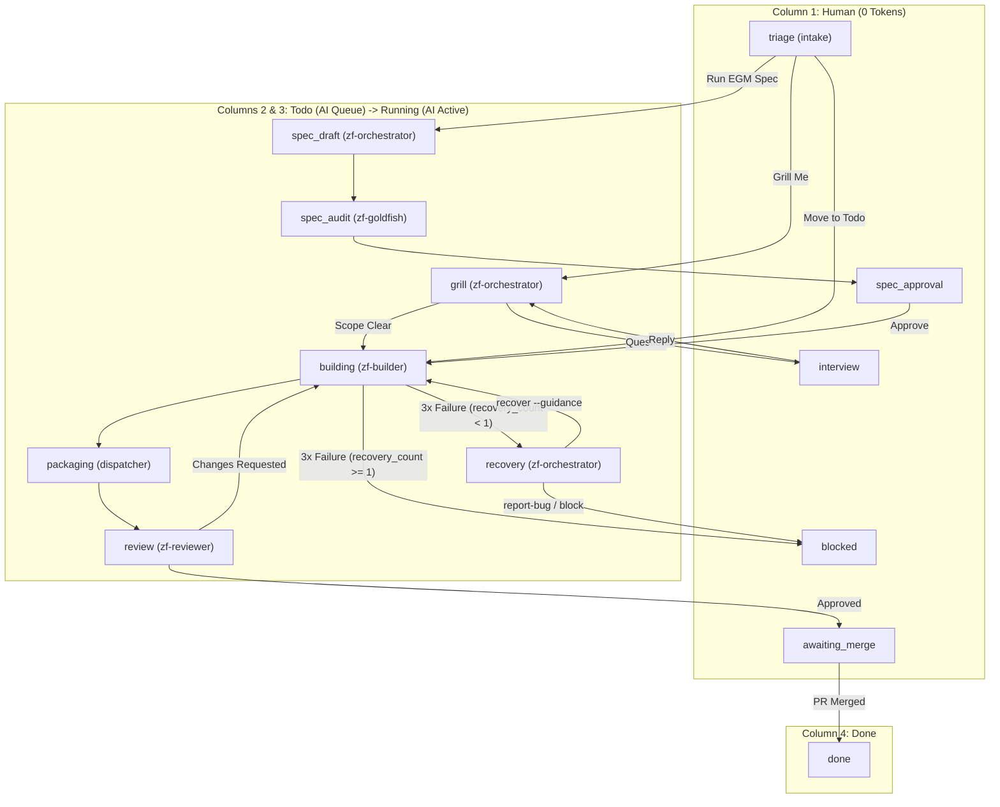

# Actor-Based 4-Column Kanban & 13-Stage State Machine with Autonomous Recovery

*   **Author:** ntsd
*   **Status:** Approved
*   **Date:** 2026-11-18

--------------------------------------------------------------------------------

## Overview

Zero Factory orchestrates autonomous software engineering across four specialist agent profiles (`zf-orchestrator`, `zf-goldfish`, `zf-builder`, `zf-reviewer`), a deterministic packaging engine (`dispatcher`), and a `human` operator gate.

This design unifies the task lifecycle into **13 canonical stages** (each mapped to a single fixed actor) projected onto **4 actor-separated Kanban UI columns** (`Human`, `Todo`, `Running`, `Done`). It makes `assignee` deterministically validated and enforced by the state machine and dispatcher, adds the **`recovery`** stage so `zf-orchestrator` automatically investigates tasks that exhaust their 3-attempt retry budget (to either recover them with builder guidance or report Zero Factory defects via `report-bug`), and replaces manual assignee selectors and substring-based UI heuristics with read-only stage and agent badges.

## The Problem

Today, `status` (the Kanban column) and `assignee` (the actor responsible for the task) are stored as independent mutable columns in the `tasks` SQLite table, and sub-stage state is fragmented across six separate fields (`assignee`, `metadata.triage_phase`, `metadata.awaiting_interview`, `metadata.awaiting_approval`, `metadata.awaiting_pr`, and `metadata.blocked_reason_type`):

1.  **Stranded Tasks in `todo` and Blocked Idle Scanners**: When a task enters `blocked` or `triage`, its `assignee` is set to `"human"`. When an operator later moves that task to `todo` via drag-and-drop or CLI without an explicit target assignee, the existing state transition preserves `"human"` (or `"unassigned"`). The dispatcher claim loop skips any `todo` row where `assignee == "human"`, leaving the task permanently stranded in `todo`. Because the idle improvement scanner only runs when a board's `todo` count is below its threshold (default 2), two stranded `human` tasks in `todo` also halt all automated improvement scanning for that board.
2.  **Orphaned Autonomous Recovery & Bug Reporting Pipeline**: When `scripts/zf_queue_watchdog.py` was removed in an earlier codebase consolidation, autonomous orchestrator recovery (`POST /tasks/{id}/recover` and `POST /tasks/{id}/report-bug`) became unreachable. When a worker exhausts its 3-attempt retry budget, the reaper and precommit/conflict handlers move the task directly to `blocked` (`assignee = "human"`), and nothing in the dispatcher ever spawns `zf-orchestrator` to diagnose the failure logs or report internal Zero Factory defects.
3.  **Split Human Inbox & Unintended Token Spend on GitHub Issue Sync**: Human action items are split across opposite ends of the 5-column board (`triage` on the far left and `blocked` on the far right). Meanwhile, the issue importer, board sync endpoints, and CLI parser default `assignee` to `"zf-orchestrator"` instead of `"human"`, immediately triggering an LLM worker session on GitHub issue import instead of parking in the 0-token human intake gate.
4.  **Mismatched Timeout & Orphan Recovery for `zf-orchestrator` and Manual UI Footguns**: When a `zf-orchestrator` worker exceeds the running timeout or is recovered as an orphan, `dispatcher/reaper.py` routes the task to `todo` instead of `triage`, and moving an unapproved `triage` task to `todo` leaves stale triage metadata (`triage_phase`, `awaiting_approval`) that causes the reaper to misclassify `zf-builder` completion. Furthermore, the task creation and detail modals expose editable Assignee dropdowns while the Kanban board relies on fragile substring checks on titles and serialized metadata.

## Goals

*   **4 Actor-Separated Kanban UI Columns (`Human`, `Todo`, `Running`, `Done`)**: Consolidate all human-owned 0-token gates (`triage`, `interview`, `spec_approval`, `awaiting_merge`, `blocked`) into a single urgency-sorted **`Human`** column, make **`Todo`** a dedicated AI dispatch queue (`grill`, `spec_draft`, `spec_audit`, `building`, `review`, `recovery` with `worker_pid = None`), keep **`Running`** for active AI subprocesses and deterministic PR packaging, and use **`Done`** for terminal completed tasks.
*   **13 Canonical Task Stages with Fixed Actor Ownership**: Compute a deterministic `stage` and `ui_column` on every serialized task from `(status, assignee, pr_url, metadata)` and enforce valid `(status, assignee)` combinations across all write paths.
*   **Native Autonomous `recovery` Stage (`zf-orchestrator`)**: Route tasks that exhaust their 3-attempt retry budget (with `orchestrator_recovery_count < 1`) into `stage = "recovery"` (`assignee = "zf-orchestrator"`) so `zf-orchestrator` inspects failure logs and executes `recover --guidance` (back to `building`), `report-bug` (filing a Zero Factory issue and moving to `blocked`), or `block` (moving to `blocked`).
*   **Automatic Self-Healing in Dispatcher**: Ensure the dispatch claim loop automatically repairs any existing or externally modified `todo` row with `assignee in ("human", "unassigned", "")` to `"zf-builder"` in SQLite and claims it in the same dispatch cycle.
*   **0-Token GitHub Issue Intake**: Ensure GitHub issue imports and newly created `triage` tasks default to `assignee = "human"` (`stage = "triage"`, `ui_column = "human"`) until explicitly activated via **Grill-with-Docs** (1-turn interactive operator Q&A triage mode) or **Sequential EGM** (2-stage Elephant specification drafting followed by Goldfish adversarial specification audit).
*   **Read-Only UI Stage & Agent Badges**: Remove editable Assignee dropdowns from task creation and detail modals, replace substring matching on board cards with `task.stage`, and rebuild the frontend bundle.

## Non-Goals

*   **Expanding the Board to 8–13 Separate Horizontal Columns**: The 13 stages are rendered as badges inside the 4 actor-separated columns (`Human`, `Todo`, `Running`, `Done`) so the board fits on a single screen without horizontal scrolling.
*   **Adding Mutable `stage` or `ui_column` Columns to SQLite**: Both `stage` and `ui_column` are computed deterministically on read during row serialization and never stored as separate mutable SQLite columns that could drift out of sync.
*   **Removing `tasks.assignee` or `tasks.status` from SQLite or CLI Filters**: The underlying `status` (`triage`, `todo`, `running`, `blocked`, `done`) and `assignee` columns remain in SQLite for CLI backwards compatibility, dispatcher concurrency tracking, and the Agents dashboard tab.
*   **Jira Issue Support**: Only GitHub issues are supported for external issue import and PR status replies.

## Open Questions

*   None.

## Critical User Journeys (CUJs)

### CUJ 1: Operator Views Unified `Human` Inbox and Moves a Task to `Todo`

*   **Given**: Tasks exist across `triage`, `interview`, `spec_approval`, `awaiting_merge`, and `blocked` (all with `assignee = "human"`).
*   **When**: The operator views the Kanban board or drags a card from the `Human` column into the `Todo` column (or runs `hermes zerofactory move <task_id> todo`).
*   **Then**: The `Human` column displays all human-gated cards sorted by stage urgency (`awaiting_merge` -> `spec_approval` -> `interview` -> `blocked` -> `triage`). Dropping a card into `Todo` sets `status = "todo"` and `assignee = "zf-builder"` (`stage = "building"`, `ui_column = "todo"`), clears stale `blocked_reason`, failure counters, `awaiting_approval`, and unapproved `triage_phase` flags, and dispatches `zf-builder` on the next cycle.

### CUJ 2: Autonomous Failure Diagnosis & Bug Reporting in `recovery` Stage

*   **Given**: A task in `building` (or `review`) fails `.zerofactory/precommit.sh`, hits merge conflicts, or crashes/times out 3 times (`fail_retries >= 3`, `precommit_retries > 3`, or `conflict_retries > 3`) and has `orchestrator_recovery_count == 0`.
*   **When**: The reaper or precommit/conflict failure handler processes the 3rd failure.
*   **Then**: Instead of immediately blocking for a human, the task transitions to `stage = "recovery"` (`status = "todo"`, `assignee = "zf-orchestrator"`, `metadata.triage_phase = "recovery"`, `ui_column = "todo"`). The dispatcher claims it into `Running` and spawns `zf-orchestrator` with pre-digested failure logs. `zf-orchestrator` either runs `hermes zerofactory recover <id> --guidance "..."` (incrementing `orchestrator_recovery_count = 1`, resetting retry counters, and routing back to `building`) or runs `hermes zerofactory report-bug --task <id> ...` / `block` (moving the task to `stage = "blocked"` in the `Human` column). If it fails a second cycle (`orchestrator_recovery_count >= 1`), it routes directly to `blocked` (`Human` column).

### CUJ 3: Dispatcher Auto-Heals Legacy Stuck `todo` Tasks

*   **Given**: An existing database contains tasks in `status = "todo"` with `assignee = "human"` or `assignee = "unassigned"`.
*   **When**: The periodic dispatch cycle executes its claim step.
*   **Then**: The dispatcher rewrites `assignee = "zf-builder"` in the `tasks` table, claims the task into `running` (when capacity allows), and unblocks the board's idle improvement scanner once the `todo` queue drops below the idle scan threshold.

### CUJ 4: GitHub Issue Sync & Explicit Triage Activation

*   **Given**: A repository linked to a board has open GitHub issues with AI-request labels.
*   **When**: Issues are imported via dashboard sync or CLI `import-gh-issue`.
*   **Then**: Each imported task is created in `status = "triage"` with `assignee = "human"`, `stage = "triage"`, and `ui_column = "human"`, consuming 0 LLM tokens until the operator clicks **Grill Me** (`stage = "grill"`, `ui_column = "todo"`) or **Run EGM Spec** (`stage = "spec_draft"`, `ui_column = "todo"`).

## Technical Plan (Architecture)

### 1. The 4-Column / 13-Stage State Machine

Every task maps deterministically to one of **13 canonical stages** (12 active/human/AI workflow stages plus terminal `done`), one **fixed actor**, and one of **4 Kanban UI columns** (`human`, `todo`, `running`, `done`). Stage derivation evaluates terminal `done` first, then `blocked`, then `triage`, and finally `todo`/`running`:

| Kanban UI Column (`ui_column`) | Canonical `stage` | Fixed Actor (`assignee`) | Underlying State Condition (Evaluated in Priority Order) |
| :--- | :--- | :--- | :--- |
| **1. `human`** *(0 tokens, sorted by urgency)* | `awaiting_merge` | `human` | `status == "blocked"` with non-empty `pr_url` and no failure/escalation flags (`changes-requested`, `stuck`, `permanently_blocked`, `conflict_retries`, `precommit_retries`, `review_cap_reached`). |
| **1. `human`** | `spec_approval` | `human` | `status == "triage"` with `awaiting_approval == True` or `triage_phase == "human_approval"`. |
| **1. `human`** | `interview` | `human` | `status == "triage"` with `awaiting_interview == True`. |
| **1. `human`** | `blocked` | `human` | `status == "blocked"` without an approved ready-to-merge PR (retries exhausted after recovery, reported Zero Factory bug, parent task blocker, or manual block). |
| **1. `human`** | `triage` | `human` | `status == "triage"` with `assignee == "human"` and no interview/approval flags (initial intake). |
| **2. `todo`** *(queued)* / **3. `running`** *(active)* | `grill` | `zf-orchestrator` | `assignee == "zf-orchestrator"` with `egm == False` and `triage_phase != "recovery"` (`status == "triage"` when queued in `ui_column == "todo"`; `status == "running"` when active in `ui_column == "running"`). |
| **2. `todo`** *(queued)* / **3. `running`** *(active)* | `spec_draft` | `zf-orchestrator` | `assignee == "zf-orchestrator"` with (`egm == True` or `triage_phase == "elephant_drafting"`) and `triage_phase != "recovery"` (`status == "triage"` when queued; `status == "running"` when active). |
| **2. `todo`** *(queued)* / **3. `running`** *(active)* | `spec_audit` | `zf-goldfish` | `status in ("todo", "running")` with `assignee == "zf-goldfish"` or `triage_phase == "goldfish_auditing"`. |
| **2. `todo`** *(queued)* / **3. `running`** *(active)* | `building` | `zf-builder` | `status in ("todo", "running")` with `assignee == "zf-builder"` (and not `awaiting_pr`). |
| **2. `todo`** *(queued)* / **3. `running`** *(active)* | `review` | `zf-reviewer` | `status in ("todo", "running")` with `assignee == "zf-reviewer"`. |
| **2. `todo`** *(queued)* / **3. `running`** *(active)* | `recovery` | `zf-orchestrator` | `status in ("todo", "running")` with `assignee == "zf-orchestrator"` and `triage_phase == "recovery"`. |
| **3. `running`** *(0 LLM tokens)* | `packaging` | `zf-builder` (packaged by `dispatcher`) | `status == "running"` with `awaiting_pr == True` (deterministic precommit, commit, push, PR creation). |
| **4. `done`** *(Terminal)* | `done` | completing agent | `status == "done"`. |

#### Status-to-Assignee Validation Rules

| Target `status` | Resolution Rule | Allowed `assignee` Values |
| :--- | :--- | :--- |
| `"triage"` | If an explicit target assignee is provided and normalizes to `{"human", "zf-orchestrator"}`, keep it; else if no target assignee is provided and the current assignee is `"zf-orchestrator"` (with `triage_phase != "recovery"`), keep `"zf-orchestrator"`; otherwise return `"human"`. | `"human"`, `"zf-orchestrator"` |
| `"todo"` | Candidate is the normalized target assignee if provided, else the normalized current assignee. If the candidate belongs to `{"zf-builder", "zf-reviewer", "zf-goldfish"}` (or `"zf-orchestrator"` when `triage_phase == "recovery"`), keep it; otherwise return `"zf-builder"`. Never returns `"human"` or `"unassigned"`. | `"zf-builder"`, `"zf-reviewer"`, `"zf-goldfish"`, `"zf-orchestrator"` (for `recovery`) |
| `"running"` | Candidate is the normalized target or current assignee. If the candidate is a recognized specialist profile (`{"zf-builder", "zf-reviewer", "zf-orchestrator", "zf-goldfish"}`), keep it; otherwise return `"zf-builder"`. | `"zf-builder"`, `"zf-reviewer"`, `"zf-orchestrator"`, `"zf-goldfish"` |
| `"blocked"` | If `blocked_reason_type == "changes-requested"` (transient reviewer feedback awaiting the dispatch cycle's PR review reroute step), keep the normalized target or current assignee if it is a specialist profile, else return `"zf-builder"`. For all other blocked states, return `"human"`. | `"human"` (or specialist profile for transient `"changes-requested"`) |
| `"done"` | Candidate is the normalized target or current assignee. Keep if it is a specialist profile or `"human"`, else return `"zf-builder"`. | `"zf-builder"`, `"zf-reviewer"`, `"zf-orchestrator"`, `"zf-goldfish"`, `"human"` |

### 2. Component Enforcement Boundaries & Autonomous Recovery Flow

1.  **Central State Transition Guard**: Every status transition resolves the target status's assignee through the canonical resolver. When transitioning a task into `todo` with `zf-builder` as the resolved owner, any unapproved triage or recovery flags (`awaiting_approval` and `triage_phase` in `{"elephant_drafting", "goldfish_auditing", "human_approval", "recovery"}`) are cleared. When transitioning a task with `triage_phase == "recovery"` into `blocked`, `triage_phase` is cleared and `orchestrator_recovery_count` is set to at least `1`.
2.  **Autonomous Failure Recovery Gate (`recovery` Stage)**: When any non-orchestrator worker exhausts its 3-attempt retry budget (worker crash/timeout, precommit failure, or merge-conflict exhaustion) and `orchestrator_recovery_count < 1`, the engine clears `awaiting_pr`, sets `triage_phase = "recovery"`, and transitions the task to `status = "todo"`, `assignee = "zf-orchestrator"` (`stage = "recovery"`, `ui_column = "todo"`). When claimed into `running`, the worker spawner evaluates `triage_phase == "recovery"` ahead of EGM/Grill triage modes, injects pre-digested failure logs (`last_worker_failure`, `last_precommit_error`), and instructs `zf-orchestrator` to run `recover --guidance`, `report-bug`, or `block`. If `zf-orchestrator` exits 0 without changing the task's state (or crashes/times out in `recovery`), the reaper transitions it to `blocked` (`assignee = "human"`, `orchestrator_recovery_count = 1`, `permanently_blocked = True`, `triage_phase = None`).
3.  **API & CLI Mutation Gatekeeping**: Task creation, status moves, session stops, and partial field updates (`PATCH`) validate and normalize `assignee` against the task's current or target status before writing to SQLite. When a status move targets the `"human"` column alias, the handler maps the status to `"triage"` (for pre-implementation triage/spec tasks without a PR) or `"blocked"` (for all other tasks), forces `target_assignee = "human"`, and clears active AI triage phases (`"elephant_drafting"`, `"goldfish_auditing"`, `"recovery"`).
4.  **Dispatcher Queue Self-Healing**: During each dispatch cycle, before evaluating candidate tasks in `todo`, any row whose `assignee` is `"human"`, `"unassigned"`, or `""` (or `"zf-orchestrator"` without `triage_phase == "recovery"`) is rewritten to `"zf-builder"` in SQLite and claimed in the same cycle.
5.  **Orchestrator Timeout & Orphan Recovery Alignment**: When the worker reaper recovers a timed-out or orphaned `running` task whose assignee is `zf-orchestrator` and `triage_phase != "recovery"`, it routes the task back to `triage` rather than `todo`.
6.  **4-Column UI Projection & Urgency Sorting**: The database serializer attaches `stage` and `ui_column` (`"human"`, `"todo"`, `"running"`, `"done"`) to every task dictionary. The Kanban UI renders those 4 columns, sorts the `Human` column by stage urgency (`awaiting_merge` -> `spec_approval` -> `interview` -> `blocked` -> `triage`), and displays read-only stage and agent badges on every card and modal.

## Alternatives Considered

### Alternative A: 8–10 Separate Horizontal Kanban Columns

*   **Pros**: Gives every sub-phase of triage, specification, implementation, review, recovery, and merge its own column.
*   **Cons**: Forces horizontal scrolling across empty columns on standard screens and loses the visual distinction between queued AI tasks (`worker_pid = None`) and actively running AI tasks (`worker_pid = PID`).
*   **Reason for Rejection**: Grouping all human gates into `Human`, all queued AI stages into `Todo`, and all active AI stages into `Running` (with the 13 stages rendered as badges) preserves a 4-column single-screen layout while keeping every stage explicit.

### Alternative B: Keeping 5 Columns (`triage`, `todo`, `running`, `blocked`, `done`) Without Actor Consolidation

*   **Pros**: Matches the legacy 5-column header layout.
*   **Cons**: Splits human action items across opposite ends of the board (`triage` on the left and `blocked` on the right), forcing operators to scan two separate columns to find tasks awaiting human input.
*   **Reason for Rejection**: Consolidating all human-owned stages (`triage`, `interview`, `spec_approval`, `awaiting_merge`, `blocked`) into a single urgency-sorted `Human` column gives the operator one unified 0-token inbox.

### Alternative C: Storing Separate Mutable `stage` and `ui_column` Columns in SQLite

*   **Pros**: Allows raw SQL queries to filter by `WHERE stage = '...'` directly.
*   **Cons**: Adds extra mutable state columns alongside `status` and `assignee` that can drift out of sync across transitions.
*   **Reason for Rejection**: Computing `stage` and `ui_column` deterministically on read from `(status, assignee, pr_url, metadata)` eliminates drift between `stage`/`ui_column` and the underlying columns without requiring a SQLite schema migration.

--------------------------------------------------------------------------------

## Non-Functional Requirements

*   **Performance & Latency**: `resolve_status_assignee()`, `derive_task_stage()`, and `derive_ui_column()` are pure in-memory Python lookups with $O(1)$ time complexity and zero subprocess or network I/O.
*   **Rollout & Backward Compatibility**: Requires no SQLite schema migration (`migrations/0001_initial_schema.sql` is unchanged). Existing CLI commands (`hermes zerofactory move <id> triage|todo|running|blocked|done`) continue to work unchanged, and existing stuck `todo` rows in `~/.hermes/zerofactory.db` are repaired automatically on the first dispatch cycle.
*   **Edge-Case & Recovery Loop Guardrail**: Autonomous recovery in `stage = "recovery"` is strictly capped at 1 attempt per task (`orchestrator_recovery_count < 1`). If `zf-orchestrator` exits 0 in `recovery` without invoking `recover`, `report-bug`, or `block` (or crashes/times out), the reaper marks `orchestrator_recovery_count = 1`, clears `triage_phase`, and transitions the task to `blocked` (`Human` column) so it can never loop infinitely.

--------------------------------------------------------------------------------

## Additional Resources

*   [AGENTS.md](../../AGENTS.md) — Zero Factory architecture overview and specialist profile responsibilities
*   [FLOWS.md](../FLOWS.md) — Deterministic engine and agentic worker flow reference
*   [DEBUGGING.md](../DEBUGGING.md) — Incident playbook and three-layer triage guide
*   [concepts_brief.md](../../concepts_brief.md) — Predecessor EGM brainstorm brief

--------------------------------------------------------------------------------

## Detailed Implementation Plan

### Phase 1: Core Stage/Assignee Helpers, State Machine & Autonomous Recovery in Dispatcher/Reaper/Worktree

#### 1. `paths.py` (Modify)

*   **Type / Scope**: Shared Python Core Module
*   **Proposed Changes**:
    *   Define `VALID_TODO_ASSIGNEES = frozenset({"zf-builder", "zf-reviewer", "zf-goldfish"})`, `VALID_TRIAGE_ASSIGNEES = frozenset({"human", "zf-orchestrator"})`, `VALID_TASK_STAGES = ("triage", "interview", "spec_approval", "awaiting_merge", "blocked", "grill", "spec_draft", "spec_audit", "building", "review", "recovery", "packaging", "done")` (13 stages), and `HUMAN_STAGES = frozenset({"triage", "interview", "spec_approval", "awaiting_merge", "blocked"})`.
    *   Add pure function `resolve_status_assignee(target_status: str, current_assignee: str | None = None, target_assignee: str | None = None, blocked_reason_type: str | None = None, triage_phase: str | None = None) -> str`:
        *   `"triage"`: If `target_assignee` is not `None`, normalize via `normalize_assignee(target_assignee)` and return if in `VALID_TRIAGE_ASSIGNEES` (`{"human", "zf-orchestrator"}`), else return `"human"`. If `target_assignee` is `None`, return `"zf-orchestrator"` if `normalize_assignee(current_assignee) == "zf-orchestrator"` and `triage_phase != "recovery"`, else `"human"`.
        *   `"todo"`: Candidate is `normalize_assignee(target_assignee)` if `target_assignee is not None` else `normalize_assignee(current_assignee)`. If `triage_phase == "recovery"` and `candidate == "zf-orchestrator"`, return `"zf-orchestrator"`. Otherwise return candidate if in `VALID_TODO_ASSIGNEES` (`{"zf-builder", "zf-reviewer", "zf-goldfish"}`), else `"zf-builder"`.
        *   `"running"`: Candidate is `normalize_assignee(target_assignee if target_assignee is not None else current_assignee)`. Return candidate if in `PROFILE_MAP`, else `"zf-builder"`.
        *   `"blocked"`: If `blocked_reason_type == "changes-requested"`, candidate is `normalize_assignee(target_assignee if target_assignee is not None else current_assignee)`; return candidate if in `PROFILE_MAP` else `"zf-builder"`. For all other `blocked_reason_type` values, return `"human"`.
        *   `"done"`: Candidate is `normalize_assignee(target_assignee if target_assignee is not None else current_assignee)`. Return candidate if in `PROFILE_MAP` or `candidate == "human"`, else `"zf-builder"`.
    *   Add pure function `derive_task_stage(status: str | None, assignee: str | None, pr_url: str | None = None, metadata: dict[str, Any] | str | None = None) -> str`:
        *   Parse `metadata` into a dict `meta` if passed as a JSON string.
        *   If `status == "done"`: return `"done"`.
        *   If `status == "blocked"`: if `bool(pr_url and str(pr_url).strip())` and `meta.get("blocked_reason_type") not in ("changes-requested", "stuck")` and not `meta.get("permanently_blocked")` and not `meta.get("conflict_retries")` and not `meta.get("precommit_retries")` and not `meta.get("review_cap_reached")`, return `"awaiting_merge"`; else return `"blocked"`.
        *   If `status == "triage"`:
            *   If `meta.get("awaiting_approval")` or `meta.get("triage_phase") == "human_approval"`: return `"spec_approval"`.
            *   If `meta.get("awaiting_interview")`: return `"interview"`.
            *   If `normalize_assignee(assignee) == "zf-orchestrator"`: return `"spec_draft"` if ((`meta.get("egm")` or `meta.get("triage_phase") == "elephant_drafting"`) and `meta.get("triage_phase") != "recovery"`) else `"grill"`.
            *   Otherwise: return `"triage"`.
        *   If `status in ("todo", "running")`:
            *   If `status == "running"` and `meta.get("awaiting_pr")`: return `"packaging"`.
            *   If `normalize_assignee(assignee) == "zf-reviewer"`: return `"review"`.
            *   If `normalize_assignee(assignee) == "zf-goldfish"` or `meta.get("triage_phase") == "goldfish_auditing"`: return `"spec_audit"`.
            *   If `normalize_assignee(assignee) == "zf-orchestrator"`:
                *   If `meta.get("triage_phase") == "recovery"`: return `"recovery"`.
                *   If `meta.get("egm")` or `meta.get("triage_phase") == "elephant_drafting"`: return `"spec_draft"`.
                *   Otherwise: return `"grill"`.
            *   Otherwise: return `"building"`.
    *   Add pure function `derive_ui_column(status: str | None, stage: str | None) -> str`:
        *   If `status == "done"` or `stage == "done"`: return `"done"`.
        *   If `status == "running"` or `stage == "packaging"`: return `"running"`.
        *   If `stage in HUMAN_STAGES` (`{"triage", "interview", "spec_approval", "awaiting_merge", "blocked"}`): return `"human"`.
        *   Otherwise (`stage in {"grill", "spec_draft", "spec_audit", "building", "review", "recovery"}` when not `running`): return `"todo"`.
    *   **Rationale**: Centralizes the 13-stage, 4-column, and status-to-assignee mapping rules in `paths.py`.

#### 2. `dispatcher/config.py` and `dispatcher/__init__.py` (Modify)

*   **Type / Scope**: Dispatcher Configuration & Package Exports
*   **Proposed Changes**:
    *   Import and re-export `VALID_TODO_ASSIGNEES` and `resolve_status_assignee` from `paths.py` (with inline fallback definitions in `dispatcher/config.py`).
    *   **Rationale**: Makes the canonical assignee helpers available to `state_machine.py`, `scheduler.py`, `reaper.py`, and `worktree.py`.

#### 3. `dispatcher/state_machine.py` (Modify)

*   **Type / Scope**: Dispatcher State Machine
*   **Proposed Changes**:
    *   In `transition_task()`, compute `new_assignee = resolve_status_assignee(target_status, current_assignee=current_assignee, target_assignee=target_assignee, blocked_reason_type=meta.get("blocked_reason_type"), triage_phase=meta.get("triage_phase"))`.
    *   When `target_status == "todo"` and `new_assignee == "zf-builder"`, execute `meta.pop("awaiting_approval", None)` and if `meta.get("triage_phase") in ("elephant_drafting", "goldfish_auditing", "human_approval", "recovery")`, `meta.pop("triage_phase", None)`.
    *   When `target_status == "blocked"` and `meta.get("triage_phase") == "recovery"`, execute `meta.pop("triage_phase", None)` and `meta["orchestrator_recovery_count"] = max(1, int(meta.get("orchestrator_recovery_count", 0)))`.
    *   **Rationale**: Enforces valid `(status, assignee)` transitions and cleans up `triage_phase` when leaving `recovery` or entering `building`.

#### 4. `dispatcher/scheduler.py` (Modify)

*   **Type / Scope**: Dispatcher Claim & Scheduling Loop
*   **Proposed Changes**:
    *   In `run_dispatch_cycle()` Step 2 (lines 186–215): parse `cand_meta` before the assignee check; allow `assignee == "zf-orchestrator"` in `status == "todo"` when `cand_meta.get("triage_phase") == "recovery"`. If `row["status"] == "todo"` and `assignee not in VALID_TODO_ASSIGNEES` and not (`assignee == "zf-orchestrator"` and `cand_meta.get("triage_phase") == "recovery"`): rewrite `assignee = "zf-builder"` in SQLite (`UPDATE tasks SET assignee = ?, updated_at = ? WHERE id = ?`) and commit. (Because `recovery` tasks have `assignee == "zf-orchestrator"`, Step 2 naturally skips `zf-builder` pre-flight git worktree and conflict checks at lines 261 and 290.)
    *   **Rationale**: Self-heals legacy or externally mutated `todo` rows while allowing `recovery` tasks (`zf-orchestrator`) to be claimed from `todo`.

#### 5. `dispatcher/reaper.py`, `dispatcher/worktree.py`, and `dispatcher/worker_spawner.py` (Modify)

*   **Type / Scope**: Worker Reaper, Precommit/Conflict Failure Handlers & Orchestrator Recovery Prompt Assembly
*   **Proposed Changes**:
    *   In `dispatcher/reaper.py`:
        *   At line 226 (`retcode == 0`): exclude `meta.get("triage_phase") == "recovery"` from `is_triage_task`. Evaluate `if meta.get("triage_phase") == "recovery":` **before** the `if is_triage_task:` and `elif curr_asgn == "zf-orchestrator"` branches: if the task is still in `curr_stat == "running"` (meaning the orchestrator did not invoke `recover`, `report-bug`, or `block`), set `meta["orchestrator_recovery_count"] = max(1, int(meta.get("orchestrator_recovery_count", 0)))`, `meta["permanently_blocked"] = True`, `meta["blocked_reason_type"] = "stuck"`, `meta.pop("triage_phase", None)`, and transition the task to `status = "blocked"`, `target_assignee = "human"`.
        *   At the three retry-exhaustion branches (`if fail_retries >= max_worker_retries:` on lines 347, 421, and 528):
            *   If `curr_asgn != "zf-orchestrator"` and `int(meta.get("orchestrator_recovery_count", 0)) < 1`: pop `meta.pop("awaiting_pr", None)`, set `meta["triage_phase"] = "recovery"`, `meta["blocked_reason"] = failure_reason`, and call `transition_task(conn, task_id, "todo", target_assignee="zf-orchestrator", blocked_reason=failure_reason, metadata_patch=meta, actor="dispatcher")`.
            *   Otherwise (`curr_asgn == "zf-orchestrator"` or `int(meta.get("orchestrator_recovery_count", 0)) >= 1`): if `meta.get("triage_phase") == "recovery"`, set `meta["orchestrator_recovery_count"] = max(1, int(meta.get("orchestrator_recovery_count", 0)))` and `meta.pop("triage_phase", None)`; set `meta["permanently_blocked"] = True`, `meta["blocked_reason_type"] = "stuck"`, and transition to `status = "blocked"`, `target_assignee = "human"`.
        *   In all four retry/orphan branches (lines 379–382, 449–452, 491, and 553): route `curr_asgn == "zf-orchestrator"` back to `"triage"` only when `meta.get("triage_phase") != "recovery"` (when `triage_phase == "recovery"`, orphan recovery returns to `"todo"`, and any crash/timeout of `recovery` itself parks in `"blocked"` with `orchestrator_recovery_count = 1`).
    *   In `dispatcher/worktree.py`:
        *   In `_handle_precommit_failure()` (line 1138), `_handle_local_merge_conflict()` (line 646), and `_handle_pr_conflict_from_github()` (line 919), when `retries > max_retries`: if `int(meta.get("orchestrator_recovery_count", 0)) < 1`, pop `meta.pop("awaiting_pr", None)`, set `meta["triage_phase"] = "recovery"`, and transition the task to `status = "todo"`, `target_assignee = "zf-orchestrator"` instead of `status = "blocked"`. Otherwise (`orchestrator_recovery_count >= 1`), pop `awaiting_pr`, set `meta.pop("triage_phase", None)`, and transition to `status = "blocked"`, `target_assignee = "human"`.
    *   In `dispatcher/worker_spawner.py`:
        *   Under `elif assignee == "zf-orchestrator":` (line 343), evaluate `if task_meta.get("triage_phase") == "recovery":` **before** `if is_egm:`. Inject `task_meta.get("last_worker_failure")`, `task_meta.get("last_precommit_error")`, and `task_meta.get("blocked_reason")`, and instruct `zf-orchestrator` to diagnose the failure and execute one of:
            1. `hermes zerofactory recover {task_id} --guidance "<actionable fix instructions for zf-builder>"`
            2. `hermes zerofactory report-bug --task {task_id} --title "<defect title>" --body "<stack trace & failure details>"`
            3. `hermes zerofactory block {task_id} --reason "<external blocker explanation>"`
    *   **Rationale**: Wires 1-shot autonomous `recovery` and Zero Factory bug reporting across worker crashes, timeouts, precommit failures, and merge conflicts without speculative config flags.

*   **Phase 1 Verification Checkpoint**: Run `pytest tests/unit/test_paths.py tests/unit/dispatcher/test_state_machine.py tests/unit/dispatcher/test_scheduler.py tests/unit/dispatcher/test_reaper.py tests/unit/dispatcher/test_precommit_dispatcher.py`.

---

### Phase 2: Dashboard DB Serialization, API Routes & GitHub Issue Importer

#### 6. `dashboard/models.py` and `dashboard/db.py` (Modify)

*   **Type / Scope**: Dashboard Data Models & SQLite Serialization
*   **Proposed Changes**:
    *   In `dashboard/models.py`, import and re-export `VALID_TODO_ASSIGNEES`, `VALID_TASK_STAGES`, `HUMAN_STAGES`, `resolve_status_assignee`, `derive_task_stage`, and `derive_ui_column` from `paths.py`.
    *   In `dashboard/db.py` (`row_to_dict()`), compute `d["stage"] = derive_task_stage(d.get("status"), d.get("assignee"), d.get("pr_url"), d.get("metadata"))` and `d["ui_column"] = derive_ui_column(d.get("status"), d["stage"])`.
    *   **Rationale**: Attaches both `stage` (13 values) and `ui_column` (`"human"`, `"todo"`, `"running"`, `"done"`) to every serialized task.

#### 7. `dashboard/routes/tasks.py` (Modify)

*   **Type / Scope**: FastAPI Task Routes
*   **Proposed Changes**:
    *   In `create_task()` (lines 290–294): compute `assignee_val = resolve_status_assignee(status_val, target_assignee=req.assignee)`.
    *   In `stop_task_session()` (line 630): compute `assignee = resolve_status_assignee(target_status, current_assignee=task.get("assignee"))` and use it in both `transition_task()` and the fallback `UPDATE`.
    *   In `update_task()` (`PATCH /tasks/{id}`, lines 740–787): change line 775 to `SELECT status, assignee, metadata FROM tasks WHERE id = ?` (binding `curr_status`, `curr_assignee`, and `existing_meta`) and move `if req.assignee is not None:` after that query so `asgn = resolve_status_assignee(curr_status, current_assignee=curr_assignee, target_assignee=req.assignee, blocked_reason_type=existing_meta.get("blocked_reason_type"), triage_phase=existing_meta.get("triage_phase"))`.
    *   In `move_task()` (`POST /tasks/{id}/move`, lines 830–1055):
        *   Update line 833 to `if req.status not in VALID_STATUSES and req.status != "human": raise HTTPException(status_code=400, detail=f"Invalid status: {req.status}")`.
        *   Update line 860 to `SELECT status, assignee, metadata, board_slug, title, pr_url FROM tasks WHERE id = ?`.
        *   Immediately after parsing `prev_status` and `meta`, if `req.status == "human"`: map `req.status = "triage"` if (`prev_status == "triage"` or `(not curr["pr_url"] and meta.get("triage_phase") in ("elephant_drafting", "goldfish_auditing", "human_approval"))`) else `"blocked"`, set `req.assignee = "human"`, and if `meta.get("triage_phase") in ("elephant_drafting", "goldfish_auditing", "recovery")`, pop `meta.pop("triage_phase", None)` and set `meta_updated = True`.
        *   Compute `resolved_assignee = resolve_status_assignee(new_status, current_assignee=curr["assignee"], target_assignee=getattr(req, "assignee", None), blocked_reason_type=meta.get("blocked_reason_type"), triage_phase=meta.get("triage_phase"))` and `assignee_changed = (resolved_assignee != curr["assignee"])`.
        *   When `new_status == "todo"` and `resolved_assignee == "zf-builder"`, clear `meta.pop("awaiting_approval", None)` and clear `meta.pop("triage_phase", None)` if `meta.get("triage_phase") in ("elephant_drafting", "goldfish_auditing", "human_approval", "recovery")` (setting `meta_updated = True` if modified).
        *   When `new_status == "blocked"` and `meta.get("triage_phase") == "recovery"`, pop `meta.pop("triage_phase", None)` and set `meta["orchestrator_recovery_count"] = max(1, int(meta.get("orchestrator_recovery_count", 0)))` (`meta_updated = True`).
        *   Gate line 1033 on `if prev_status != req.status or meta_updated or assignee_changed:`.
    *   In `recover_task()` and before the first return branch in `report_task_bug()`: pop `meta.pop("triage_phase", None)` and ensure `report_task_bug()` sets `meta["orchestrator_recovery_count"] = max(1, int(meta.get("orchestrator_recovery_count", 0)))`.
    *   **Rationale**: Supports 4-column UI drag-and-drop (`human`, `todo`, `running`, `done`) and enforces valid `(status, assignee)` pairs and recovery metadata cleanup across all routes.

#### 8. `issues/importer.py`, `dashboard/routes/boards.py`, and `__init__.py` (Modify)

*   **Type / Scope**: External GitHub Issue Ingestion & CLI Parser
*   **Proposed Changes**:
    *   In `issues/importer.py` (`import_external_issue()`): change default `assignee: str = "human"` (line 118) and update lines 178–181 fallback to `"human"`.
    *   In `dashboard/routes/boards.py` (`sync_board_gh_issues_endpoint()` line 1073 and `import_board_gh_issue_endpoint()` line 1149): change default `assignee` fallback from `"zf-orchestrator"` to `"human"`.
    *   In `__init__.py` (line 443): change `p_import_gh.add_argument("--assignee", default="human", ...)`.
    *   **Rationale**: Enforces the 0-token `Human` column intake gate (`stage = "triage"`) for imported GitHub issues.

*   **Phase 2 Verification Checkpoint**: Run `pytest tests/unit/dashboard/test_db_helpers.py tests/unit/issues/test_issues.py tests/integration/test_tasks_api.py`.

---

### Phase 3: 4-Column Frontend UI, Bundle Build, Documentation & Test Suite

#### 9. `dashboard/src/constants.js`, `dashboard/src/components/KanbanBoard.jsx`, `dashboard/src/modals/NewTaskModal.jsx`, `dashboard/src/modals/TaskDetailModal.jsx`, `dashboard/src/App.jsx`, `dashboard/dist/index.js`, and `dashboard/dist/style.css` (Modify)

*   **Type / Scope**: React Frontend Components & Compiled Bundles
*   **Proposed Changes**:
    *   In `dashboard/src/constants.js`:
        *   Update `COLUMNS` to the 4 actor-based columns:
            1. `{ id: "human", title: "Human", icon: "👤", dotColor: "#818cf8", desc: "Human gates, triage & approvals" }`
            2. `{ id: "todo", title: "Todo", icon: "📋", dotColor: "#38bdf8", desc: "AI queue waiting for dispatch" }`
            3. `{ id: "running", title: "Running", icon: "⚡", dotColor: "#fbbf24", desc: "Active autonomous AI workers" }`
            4. `{ id: "done", title: "Done", icon: "✅", dotColor: "#a78bfa", desc: "Completed & merged" }`
        *   Export `STAGE_META` mapping all 13 canonical `stage` values (`triage`, `interview`, `spec_approval`, `awaiting_merge`, `blocked`, `grill`, `spec_draft`, `spec_audit`, `building`, `review`, `recovery`, `packaging`, `done`) to `{ label, icon, badgeClass, urgency }`.
        *   Export `COLUMN_DEFAULT_PREVIEW = { human: "👤 Human • Triage Intake (0 tokens)", triage: "👤 Human • Triage Intake (0 tokens)", todo: "🔨 ZF Builder • Building", running: "🔨 ZF Builder • Building", blocked: "👤 Human • Blocked", done: "✅ Done" }` for `NewTaskModal.jsx`.
    *   In `dashboard/src/App.jsx`:
        *   Update `tasksByColumn` (line 1223) to group tasks into `{ human: [], todo: [], running: [], done: [] }` using `t.ui_column` (or mapping `triage` and `blocked` to `human`), and sort `map.human` by `STAGE_META[t.stage].urgency` (`awaiting_merge` = 0, `spec_approval` = 1, `interview` = 2, `blocked` = 3, `triage` = 4) then priority (`P0`–`P3`).
        *   Remove `assignee: "unassigned"` from `newTaskForm` default state.
    *   In `dashboard/src/components/KanbanBoard.jsx`:
        *   Update board grid from 5 columns (`grid-cols-5`) to 4 columns (`grid-cols-4`, `repeat(4, minmax(250px, 1fr))`).
        *   Render the canonical stage badge from `STAGE_META[t.stage]` and replace substring checks on `t.metadata`, `t.description`, and `t.title` with `t.stage` lookups while preserving `isMultiRepoTriage`, `conflict_retries`, and `t.blocking_parent_count > 0`.
        *   Update the triage action buttons guard (lines 337–345) to show **Grill Me** / **Run EGM Spec** when `t.stage === "triage"`.
    *   In `dashboard/src/modals/NewTaskModal.jsx` and `dashboard/src/modals/TaskDetailModal.jsx`:
        *   Remove editable Assignee `<select>` inputs and display read-only stage (`STAGE_META[selectedTask.stage]`) and agent (`selectedTask.assignee`) badges.
    *   Run `npm run build` to regenerate `dashboard/dist/index.js` and `dashboard/dist/style.css`.
    *   **Rationale**: Implements the 4-column actor-separated Kanban UI (`Human`, `Todo`, `Running`, `Done`) with 13 read-only stage badges and urgency sorting in `Human`.

#### 10. `docs/FLOWS.md` (Modify)

*   **Type / Scope**: Architecture & Flow Documentation
*   **Proposed Changes**:
    *   Update Section 2.2 / 2.5 and Section 10 to document the 4 UI columns (`Human`, `Todo`, `Running`, `Done`), the 13 canonical stages (including `recovery`), `resolve_status_assignee()`, and the `"human"` default on GitHub issue import.
    *   **Rationale**: Keeps reference documentation synchronized with the engine and UI.

#### 11. `tests/unit/test_paths.py`, `tests/unit/dispatcher/test_state_machine.py`, `tests/unit/dispatcher/test_scheduler.py`, `tests/unit/dispatcher/test_reaper.py`, `tests/unit/dispatcher/test_precommit_dispatcher.py`, `tests/unit/dashboard/test_db_helpers.py`, `tests/unit/issues/test_issues.py`, and `tests/integration/test_tasks_api.py` (Modify)

*   **Type / Scope**: Unit & Integration Test Suite
*   **Proposed Changes**:
    *   Add unit and integration tests for `resolve_status_assignee()`, `derive_task_stage()` (all 13 stages including `recovery`), `derive_ui_column()` (all 4 columns), `scheduler.py` self-healing and `recovery` claiming, `worker_spawner.py` recovery prompt generation (including precedence over `is_egm`), `reaper.py` and `worktree.py` 1-shot `recovery` routing on 3× retry exhaustion and `blocked` routing when `orchestrator_recovery_count >= 1`, and update existing test assertions in `test_reaper.py`, `test_precommit_dispatcher.py`, and `test_issues.py`.
    *   **Rationale**: Full test coverage for the 4-column / 13-stage model and autonomous recovery pipeline.

### Verification Plan

*   **Compilation/Build**: `npm run build` (regenerates `dashboard/dist/index.js` and `dashboard/dist/style.css`).
*   **Unit & Integration Tests**: `PATH="$HOME/.hermes/tools/python-3.14"*"/bin:$PATH" bash .zerofactory/precommit.sh`.
*   **Static Analysis & Linting**: `ruff check .` and `ruff format --check .`.
*   **Live Host Database Verification**: Verify that the two existing stranded tasks (`zf-z-279f3e88` and `zf-z-a7b9e1fe`) in the local host database `~/.hermes/zerofactory.db` are auto-healed from `assignee='human'` to `assignee='zf-builder'` on the next dispatch cycle.

--------------------------------------------------------------------------------

<!-- Provenance: Indicates initial structural drafting via EGM. -->

*Drafted with EGM*
